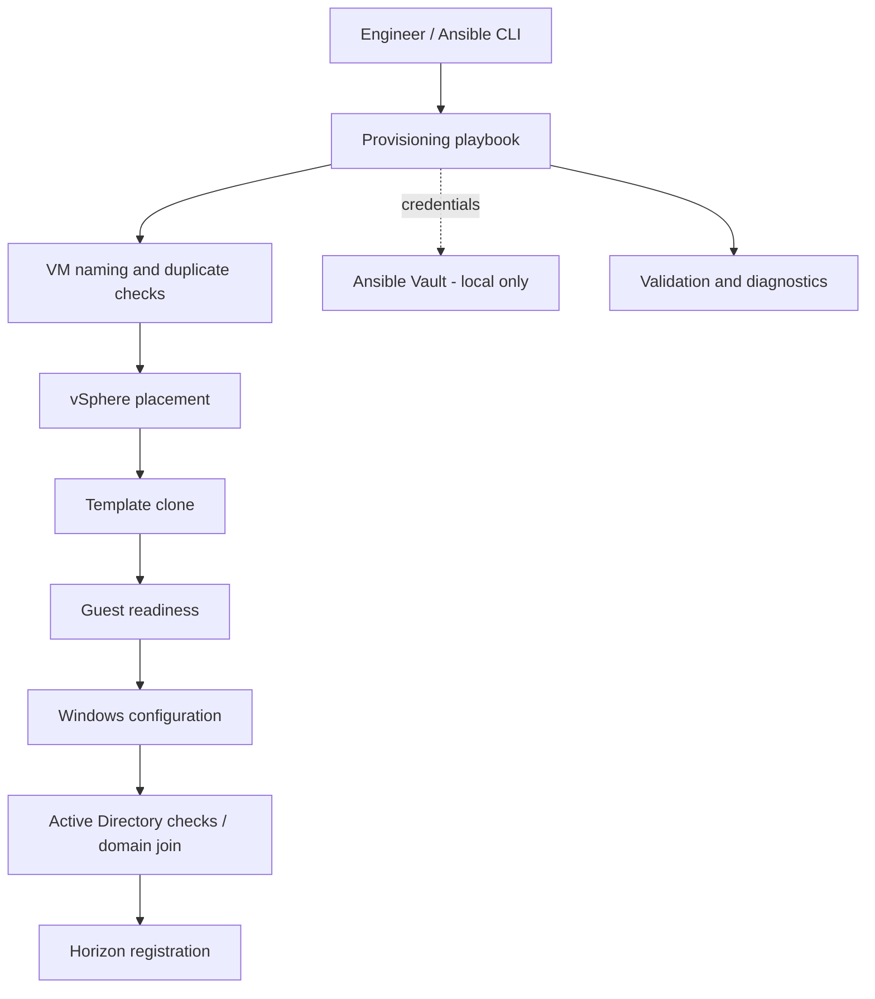

# Ansible VMware vSphere VM Provisioning


**Role-based automation for provisioning Windows virtual desktops on VMware vSphere, with Active Directory preflight checks and VMware Horizon registration.**


## Highlights

- VM naming and collision checks before cloning
- vSphere placement selection and template cloning
- Guest readiness checks, Windows configuration and validation
- Active Directory preflight validation
- VMware Horizon desktop integration
- Resume modes for interrupted Windows or Horizon stages
- Diagnostic playbooks and a helper script for VM annotations
- Separated inventory configuration and Ansible Vault credentials

## Architecture



## Repository layout

```text
inventory/                 # Example inventory, site settings and Vault template
playbooks/deploy_example.yml # Provision / resume orchestration
playbooks/diagnostics/     # Read-only inspection playbooks
roles/                     # 10 focused automation roles
scripts/                   # vSphere annotation utility
.github/workflows/         # Static checks; never connects to infrastructure
```

## Prerequisites

- Ansible on Linux, Python and dependencies from `requirements.txt`
- Collections from `requirements.yml`
- Access to an **authorized lab** with VMware vCenter, a Windows template, Active Directory and Horizon (for the complete workflow)
- Properly scoped service accounts and a local encrypted Vault file

## Local setup (no deployment)

```bash
python3 -m venv .venv
source .venv/bin/activate
pip install ansible-core -r requirements.txt
ansible-galaxy collection install -r requirements.yml
cp inventory/group_vars/all/vault.example.yml inventory/group_vars/all/vault.yml
# Replace placeholders with lab-only credentials, then encrypt the file:
ansible-vault encrypt inventory/group_vars/all/vault.yml
ansible-playbook --syntax-check playbooks/deploy_example.yml
```

**Never commit `inventory/group_vars/all/vault.yml`.** CI performs static checks only; it does not run deployment tasks against real infrastructure. The demo inventory is intentionally nonfunctional until adapted to an authorized environment.

## Deployment workflow

1. Select a site (`site`) and mode (`provision` or `resume`).
2. Validate site parameters and credentials.
3. Select an available VM name and verify placement.
4. Clone from the configured Windows template.
5. Wait for guest readiness, configure Windows and validate the result.
6. Complete Horizon registration or resume an interrupted stage.

See [workflow notes](docs/WORKFLOW.md) for safeguards and limitations.

## Security and scope

- Example-only hostnames and IP addresses; no production infrastructure details
- Secrets are loaded from a **local encrypted Ansible Vault** and excluded by `.gitignore`
- `validate_certs: false` in the Horizon sample is inherited from the prototype and **must be changed to `true` with trusted certificates** before real use
- Avoid committing inventory with real hosts, logs or screenshots from production
- Review tasks and permissions before any execution: some roles change VM, AD and Horizon state

## Limitations

This public portfolio version is **not verified end-to-end in a public lab**. The CI validates syntax and repository hygiene only. Real vSphere, AD and Horizon integration needs credentials, connectivity and environment-specific testing.

